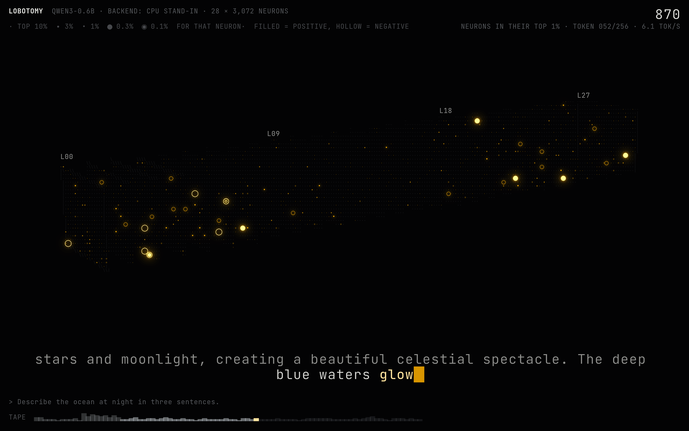

# lobotomy UI design (v0.0.2)

*From the v0.0.2 UI grill with Jake, 2026-10-26/27. Every decision has a rendered mockup in [mockups/](mockups/). All mockups draw a real recorded CPU stand-in session (Qwen3-0.6B, "Describe the ocean at night in three sentences.") and never made-up data. Prototype code (canvas, not the product) is in [web/mockups/](../../web/mockups/).*

**In one line:** the 28 layers stand side by side as a deck of dot-matrix sheets, drawn through a character grid in one amber ink. Each neuron is one dot. The dot's size and brightness show how rare this firing is *for that neuron*, and filled vs ring shows the sign. Each word sweeps through the layers in the board's real order and pace, the answer runs as subtitles, and nothing on screen is decoration.

## Decisions

| # | Question | Decision | Mockup |
|---|---|---|---|
| Q1 | Vibe | **ASCII render**: the 3D deck drawn through a character grid, with the UI on a text grid. B's glow (bloom only on real spikes), A's bright amber highlights, C's calm (dim lattice, hairline UI, few mid-tones). | [q1-vibe-sheet](mockups/q1-vibe-sheet.png) |
| Q2 | Shape | **Deck**: 28 sheets side by side, L0 → L27. Within a sheet, neurons sit by index (64 × 48, row-major) until v0.1.0's layout (R9). | [q2-shape-sheet](mockups/q2-shape-sheet.png) |
| Q3 | Glyphs | **Dots** `· ∙ • ● ◉`. Jake: ASCII symbols look like they mean something; dots read as "bigger = stronger" with no legend. The ASCII feel stays in the grid, edge strokes and text UI. | [q3-glyph-sheet](mockups/q3-glyph-sheet.png) |
| Q4 | Trails | **Half-life 2 tokens** (0.33 s at 6 tok/s), in tokens. On a live tuning knob; Jake tunes it once it runs. | [q4-trails.gif](mockups/q4-trails.gif) |
| Q5 | Layout | **Cinema** by default (full-bleed deck, answer as large subtitles, prompt line, token tape, corner HUD) **plus Console panels on a toggle key** (transcript, top-1% count per layer, rarest neurons now). | [q5-layout-sheet](mockups/q5-layout-sheet.png) |
| Q6 | Colour, type | **Mono amber**, one ink like every mood-board reference (Jake: "like astrophage in Project Hail Mary"). Sign is shape: **filled dot = positive, ring = negative**. **JetBrains Mono** for text, **Departure Mono** for the big counters. Fonts are OFL and bundled (the board serves the page offline). | [q6b-ink-sheet](mockups/q6b-ink-sheet.png), [q6-type](mockups/q6-type.png) |
| Q7 | Motion | **Sweep + idle drift.** Each word reaches layer *l* at `t₀ + (l/28)·0.9/tok_s`: the real layer order at the measured pace, one word late. The camera drifts ±9° only when idle and stops on any input. | [q7-motion.gif](mockups/q7-motion.gif) |
| Q8 | Inspect | **Hover**: a light card (value, rarity, per-word sparkline). **Click**: lock on. The layer turns face-on, other layers hide, a reticle locks, the readout docks (fires-most-on in this answer, plus grey slots for later data). **`/`** jumps (`L8 908`). Clicking a word in the subtitles or tape replays the map at that word. | [q8-inspect-sheet](mockups/q8-inspect-sheet.png) |
| Q9 | Hero moment | **Storyboard C, "one neuron → 86,016".** Open on one dot; "The ocean…" appears and the ocean neuron (L8 N908) blooms to 5.1×; pull back as layers switch on outward from L8; card "86,016 neurons · live · on a 1-watt chip". | [q9-storyboards](mockups/q9-storyboards.png), [q9-hero-c.gif](mockups/q9-hero-c.gif) |
| Q10 | Performance | **60 fps at native Retina with bloom.** If a frame is slow, drop bloom resolution, then render resolution. Never thin the data or silently drop frames. The first ticket is a bare benchmark on Jake's Mac (Jake: yes). | budget below |

Two fixes came out of the grill and are not up for taste:
- **Rarity ladder + crowding correction.** Raw max-pooling made far, crowded layers look ablaze just because each character held 30–100 neurons. See [Rarity](#rarity-what-a-dot-means).
- **Two grids.** One coarse 9 × 16 text grid gave the whole deck ~1,000 cells, about 100 neurons each, and the map went dark. The map gets a fine 5 × 8 dot grid (about one neuron per cell in the overview); the UI keeps the 9 × 16 text grid.

## Principles

1. **Every mark is data** (I6). Global, static styling (background, type, scanline-free calm) is allowed. Anything that moves or varies per element must map to a data field in the channel table.
2. **Rarity, not raw size.** A dot says how unusual this firing is for that neuron, so a quiet neuron and a loud one are comparable.
3. **Crowding can't fake activity.** A cell that holds k neurons must clear a higher bar, so a dot means the same at every zoom.
4. **Calm by default, blazing when real.** About 90% of the map is a dim lattice. Only the top 1% blooms.
5. **Honest provenance.** The HUD always names the real backend (`CPU STAND-IN` or the board), replays say `REPLAY`, and "1-watt chip" only appears on board data.
6. **Motion is data or view.** Sweep = layer order and measured pace. Trail = recency. Camera drift = view only, idle only.
7. **One text-mode language.** The map and the UI share monospace grids, box-drawing strokes and a two-font system.
8. **Tune live.** Taste numbers (trail, bloom, grid size) are knobs in the `~` console, not constants.

## Channel table (I6)

| Channel | Data field | Notes |
|---|---|---|
| Sheet (x) | layer 0–27 | L0 left, L27 right |
| Position within a sheet | neuron index (64 × 48, row-major) | arbitrary until v0.1.0's co-activation layout (R9); the inspector says so |
| Dot glyph `· ∙ • ● ◉` + brightness | rarity level of \|activation\| for that neuron: top 10 / 3 / 1 / 0.3 / 0.1% | crowding-corrected per cell (below) |
| Dot shape | sign of the activation: filled +, ring − | invisible on the two smallest levels; the hover card always shows the sign |
| Bloom | only cells at top 1% or rarer | |
| Trail | recency: max-hold that halves every 2 tokens | knob |
| Sweep timing | layer order; pace `0.9 / tok_s` | a replay of the real order, one word late |
| Dim lattice `·` | a neuron exists here (geometry) | |
| Sheet top rule, L0/L27 frames | layer boundaries | |
| Tape bar height | neurons in their top 1% at that word | |
| Big counter | same count, current word | Departure Mono |
| Console per-layer bars | top-1% count per layer, current word | |
| Reticle | the locked neuron | UI state, not data |
| Camera drift | none | view only, idle only |
| *v0.1.0: ring radius* | *steering dose* | *from the v0.1.0 map's table* |

**Debt for v0.1.0:** the map's proposed table used *size* for effect size. Size now encodes rarity, so effect size needs another channel (for example a static halo or the inspector only). Decide in v0.1.0.

## Rarity: what a dot means

For neuron *j*, `r = a / p99_j` (T2's calibration). **F** is the distribution of `|r|` pooled over all neurons and positions ≥ 1 (position 0 is the attention sink). The page seeds F from a table baked in from the CPU calibration, then updates it with a running histogram of everything this backend has streamed. A cell holding *k* neurons takes its strongest one, `m = max |r|`, and uses `u = F(m)^k` (the chance a cell of *k* ordinary neurons stays below `m`). Levels:

| Glyph + / − | Level | `u ≥` | Meaning |
|---|---|---|---|
| `·` dim | 0 | — | lattice (geometry only) |
| `·` / `·` | 1 | 0.90 | top 10% for that neuron |
| `∙` / `∘` | 2 | 0.97 | top 3% |
| `•` / `○` | 3 | 0.99 | top 1%, blooms |
| `●` / `◯` | 4 | 0.997 | top 0.3% |
| `◉` / `◎` | 5 | 0.999 | top 0.1% |

With one neuron per cell, `u` is just that neuron's percentile. Hovering a dot picks the neuron that set `m`, so the dot you see is the neuron you get. Check: on synthetic i.i.d. data, the share of cells at each level matches the single-neuron share (±10%) at 1, 4, 16 and 64 neurons per cell.

## Visual system

- **Mood board** ([moodboard/](moodboard/README.md)): one ink, small marks make form, black space with tiny exact captions, thinking shown as it happens.
- **Grids.** Map: 5 × 8 CSS px dot cells. UI: 9 × 16 CSS px text cells. Both at native device pixels.
- **Palette.** One ink. Background `#030304`. Ink amber `#FFB000`, hot `#FFE4A0` (levels 4–5, bold). Negative values use rings `∘ ○ ◯ ◎` instead of `∙ • ● ◉`. Lattice and strokes `#788491` at 14–22%. UI `#A5ACB2`, UI bright `#EEEEEA`. The tuning console has an ink-hue knob (preset: "astrophage red").
- **Type.** JetBrains Mono (UI, subtitles at 2× cell size, legend). Departure Mono for big counters. Both OFL, served from `web/dist`.
- **Sweep and trails.** Each layer keeps `glow = max(glow · 0.5^(dt/HL), new)` once the sweep has reached it. HL = 2 tokens (knob).
- **Camera.** The default overview looks down the deck from the front left (as in the mockups). Orbit, zoom and pan with the mouse. Idle drift starts after 8 s without input and stops on the first input.
- **Cinema layout.** Top left: `LOBOTOMY` and the true backend. Top right: the big top-1% counter plus `token n/256 · tok/s`. Legend under the title. Bottom: subtitles (the last two lines, the current word hot plus a block cursor), the prompt line (`> `), and the tape (one bar per token; prompt tokens dim).
- **Console (key `c`).** Left transcript, right "top 1% by layer" bars and "rarest right now" (the top 6 neurons with sign and ×p99).
- **Inspector.** Hover card: `L08 · N0908`, now `+4.7× its p99 · top 0.1%`, word, per-word sparkline. Lock-on readout adds "fires most on (this answer)" and slots. `Esc` unlocks. `/` opens a command line (`L8 908`, later label search). Clicking a word in the subtitles or tape pins the map to that token (`space` resumes live).
- **Tuning console (key `~`).** Trail half-life, bloom strength and resolution, map cell size, sweep on/off, drift on/off, ladder thresholds, plus a live fps / p95 readout. Saved in `localStorage`.
- **Record / replay.** Save a session (T2 frames + meta + calibration) to a file; drop a file to replay it. The HUD says `REPLAY · <backend> · <date>`. Replay is deterministic, so a clip renders frame by frame.
- **Hero mode C.** `?hero=c&neuron=8:908`: start macro on the neuron face-on, lock-on readout with the strongest recent value and its word, pull back over ~4 s while layers switch on outward from the neuron's layer, then the end card, with a small Voyager-style caption under it: model · backend · the real recording time (UTC). The card's claim comes from the recorded backend ("live on a 1-watt chip" only for `npu`).

## Slots for later data

The page reads an optional per-neuron record and shows grey slots until the data exists:

| Field | Arrives in | Where it shows |
|---|---|---|
| lens words (logit lens on the trimmed vocab) | v0.0.3 | hover card, lock-on "words it pushes" |
| label + one-line description + concept words | v0.1.0 | hover card title, lock-on, `/` search |
| real or not (FDR survivor, p-value) | v0.1.0 | lock-on; the overview may grey out non-survivors (channel to decide) |
| safe slider range per sign | v0.1.0 | lock-on slider; ring radius = dose |
| layout coordinates (co-activation, R9) | v0.1.0 | positions within each sheet |

## Performance budget (E6)

Target: p95 frame time ≤ 16.7 ms and ≤ 1% of frames over 33 ms on Jake's MacBook Air (Mac16,13), Safari 26 and Chrome, full window, native resolution, bloom and trails on, 60 s of live stream.

| Work per frame | Estimate on the Air's GPU |
|---|---|
| per-token upload (172 KB, 6–24×/s) | ~0 |
| trail + sweep for 86,016 neurons (compute) | < 0.2 ms |
| project and splat into the dot grid (atomic max + count) | < 0.3 ms |
| draw every cell (map dots + UI glyphs from atlases) | ~1 ms |
| bloom at half resolution | ~1.5 ms |
| **total** | **~3 of 16.7 ms** |

These are estimates; the first ticket measures them. Fallback order: bloom resolution, then render resolution. three.js `WebGPURenderer` falls back to WebGL2 if WebGPU is missing.

## Mood board

See [moodboard/](moodboard/README.md).

## Open items

- Pooled F vs per-neuron F: the ladder assumes every neuron's `|a|/p99` has the same shape. Fine for v0.0.2; the atlas can ship per-layer or per-neuron quantiles later.
- Index order inside a sheet is arbitrary; the inspector and README say so until R9.
- The real hero clip needs board data (T8). v0.0.2 delivers hero mode and a CPU-stand-in render with an honest card.
