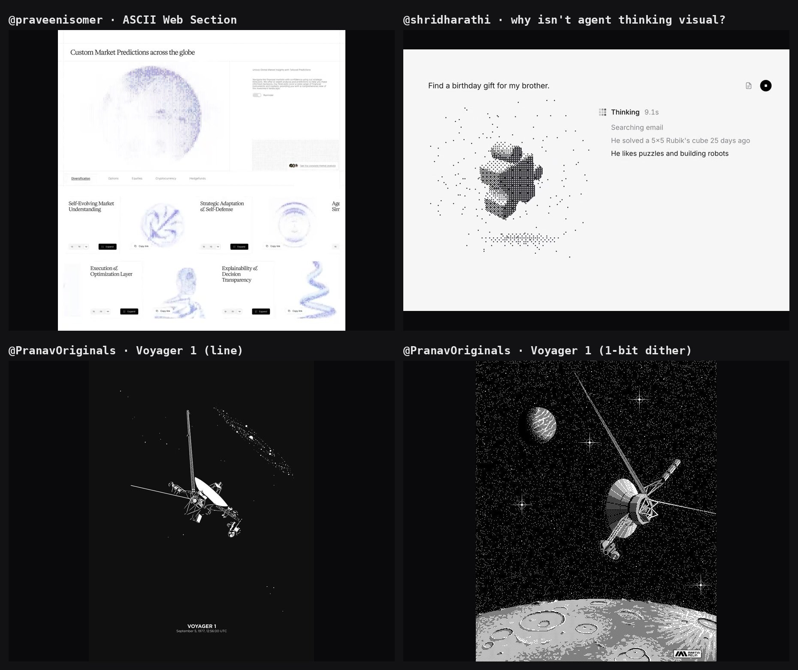

# Mood board

Jake's references for the v0.0.2 UI (pasted 2026-10-27), fetched with `api.fxtwitter.com`. The images here are reduced copies for reference, credited to their authors; the originals live at the links. Say the word and they come out of the public repo.

| Reference | What it is | What we take |
|---|---|---|
| [@praveenisomer, "ASCII Web Section"](https://x.com/praveenisomer/status/2114680944196264294) ([frames](praveenisomer-ascii-web-section.jpg)) | A web page where a globe and small 3D objects (shell, spring, figure) are rendered in periwinkle ASCII on white, next to serif headlines. | 3D form drawn by character density; one ink; editorial calm and white space around a dense object. |
| [@PranavOriginals, Voyager 1](https://x.com/PranavOriginals/status/2114390231558639635) ([line](pranavoriginals-voyager-1.jpg), [dither](pranavoriginals-voyager-2.jpg)) | Voyager 1 twice: a white line drawing on black with a tiny exact caption ("September 5, 1977, 12:56:00 UTC"), and a 1-bit dithered pixel illustration. | Black negative space; a starfield of dots; metadata as typography (a precise timestamp under the hero); tone from dither density. |
| [@shridharathi, "why isn't agent thinking visual?"](https://x.com/shridharathi/status/2113255894423158914) ([frames](shridharathi-agent-thinking.jpg)) | A chat UI where a halftone, dot-stippled 3D object changes with each thought step, beside a growing list of thoughts and a "Thinking 7.1s" timer. | Thinking made visible step by step; a running elapsed time; stipple dots as the medium. (Their floating particles are decoration; ours stay data.) |

## Shared principles

1. **Small marks make form.** Dots, characters or dither, and density does the shading. This matches the dot-matrix deck and the lattice.
2. **One ink.** All three use a single colour on a plain ground. This prompted the palette re-check ([q6b-ink-sheet](../mockups/q6b-ink-sheet.png)).
3. **Negative space and tiny exact captions.** Lots of black, and small precise metadata: `L08 · N0908`, `token 052/256`, and an end-card caption with the real recording time, Voyager-style.
4. **Show the thinking as it happens.** Text accumulates with an elapsed timer; our subtitles, tape and `n/256 · tok/s` play that role.
5. **Calm around the hero.** One dense object, quiet type around it: the Cinema layout.

## Also in the air (no images; our own references)

- Lyra's neuron-explorer: the deck, additive glow, layers left to right (docs/lyra-reports).
- Eames, *Powers of Ten* (1977): storyboard C's pull-back from one neuron.
- Demoscene ASCII tunnels: storyboard B's fly-through.
- Datashader-style aggregation: the reason for the crowding correction (a crowded cell must not look busier than one neuron).
